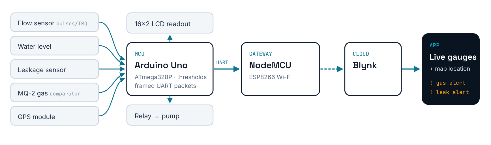
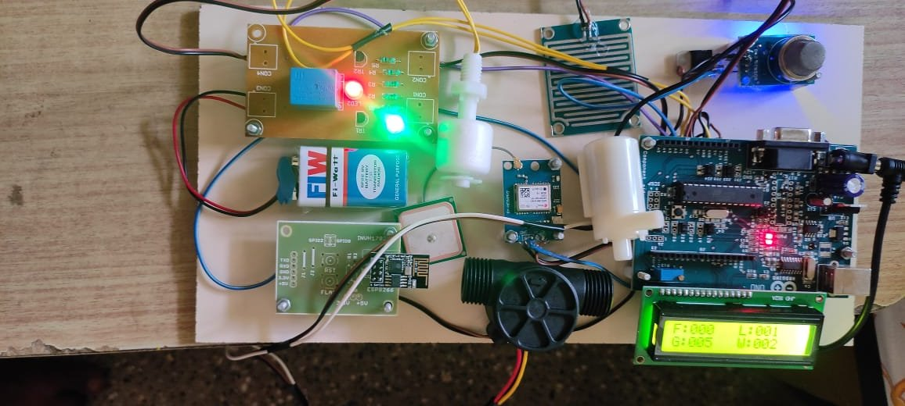
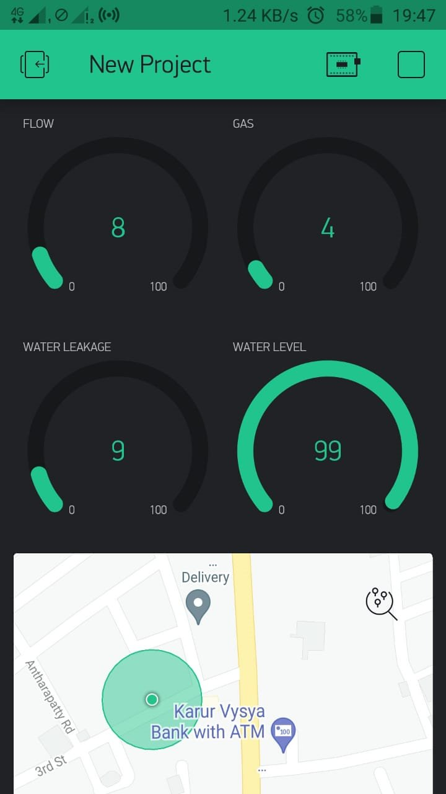
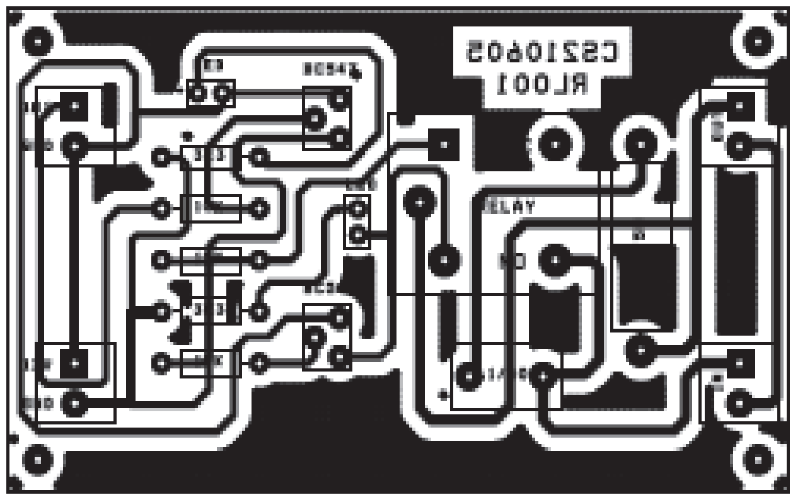
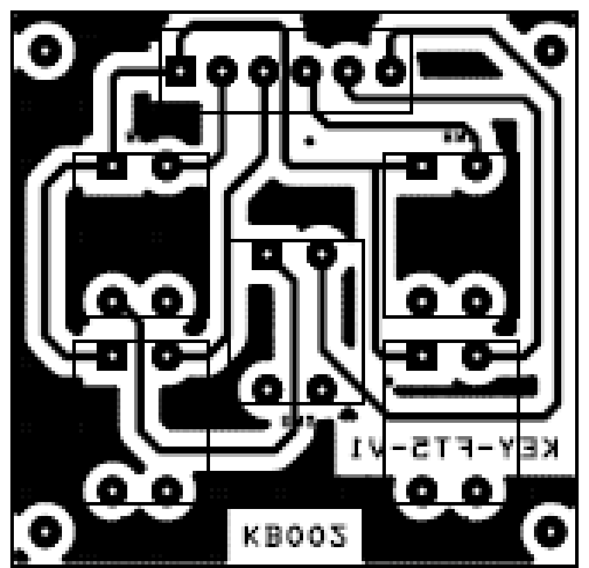

<h1 align="center">IoT Sewage Monitoring System</h1>

<p align="center">
  <b>Detect blockages, overflow and hazardous gas in drains, and alert the municipality in real time</b><br>
  <sub>B.E. Electrical &amp; Electronics Engineering thesis · Kumaraguru College of Technology · 2021 · team of three</sub>
</p>

<p align="center">
  
  
  
  
</p>

<p align="center"></p>

## The problem

In fast-growing cities, blocked sewer lines overflow during heavy rain and leave stagnant pools of untreated wastewater on the roads. Repairs are slow mainly because the information reaches the municipality late. Toxic gases (CH₄, CO, SO₂) in the drains are a further hazard to workers and residents.

## What the system does

- **Measures** flow rate (L/min and total volume), water level, leakage and gas concentration at each node
- **Locates** the node with a GPS module so crews know where the problem is
- **Acts locally:** a 16×2 LCD shows live readings, and a relay drives the pump automatically when the level crosses a threshold
- **Alerts remotely:** an ESP8266 publishes readings to Blynk and pushes notifications such as *GAS LEVEL EXCEEDED*, *WATER LEAKAGE DETECTED* and *WATER LEVEL LOW*

<p align="center">
  
  &nbsp;
  
</p>

## Hardware

| Block | Part | Notes |
|---|---|---|
| Microcontroller | Arduino Uno (ATmega328P) | Samples all sensors and applies thresholds |
| Gateway | NodeMCU (ESP8266) | UART from the Uno → Wi-Fi → Blynk |
| Flow | Magnetic-rotor flow sensor | 5 V, 15 mA, 2–10 L/min, read on INT0 |
| Gas | MQ-2 + LM741 comparator | 100–10,000 ppm LPG range, < 10 s response |
| Leakage | Pressure-type sensor | 5 V, < 20 mA, detection up to 40 mm |
| Level | Water-level sensor | Drives the pump relay at a 50 % threshold |
| Actuator | JQC-3F relay, BC547 driver pair | Pump control |
| Display | 16×2 LCD | Flow / level / gas / leakage |
| Location | GPS module | Position reported in the app |

Custom single-sided PCBs were designed for the power supply, the relay driver and the keypad:

<p align="center">
  
  &nbsp;
  
</p>

## Firmware

```
firmware/
├── sewage_node_uno/          Arduino Uno: sensing, LCD, pump control, UART packets
└── esp8266_blynk_gateway/    NodeMCU: parses packets, Blynk virtual pins, push alerts
```

The Uno sends a fixed 13-byte ASCII frame to the gateway every 500 ms:

```
'*' FFF GGG WWW LLL      e.g.  *012008003074
     │   │   │   └── level   [%]
     │   │   └────── leakage [%]
     │   └────────── gas     [%]
     └────────────── total flow [L]
```

**Flashing:** open each sketch in the Arduino IDE. The gateway needs the ESP8266 board package and the Blynk library. Enter your own Blynk token and Wi-Fi credentials in `esp8266_blynk_gateway.ino` before uploading.

> The code targets the legacy Blynk platform (2021). To use Blynk IoT, add `BLYNK_TEMPLATE_ID`/`BLYNK_TEMPLATE_NAME` and replace `Blynk.notify()` with `Blynk.logEvent()`. Compared with the original appendix, the firmware here has been tidied (named pins, a shared zero-padding helper, and re-synchronisation on the `*` start byte); its behaviour is unchanged.

## Future scope (from the thesis)

- Power the node from a small **solar cell** to cut running costs
- Switch from Wi-Fi to **LoRaWAN**, because Wi-Fi is rarely available near sewer lines
- Multi-hop **WSN clustering** to extend node lifetime, and a gateway hardened against Wi-Fi jamming

## Team

Ajeeth V, Mohamed Fayas B and Kathiresh R, supervised by Mr. N. Mohana Sundaram (Asst. Prof., EEE), Kumaraguru College of Technology, Coimbatore.

---

<sub>Maintained by <a href="https://github.com/ajeethv27">Ajeeth Venkat Prasat</a> · <a href="https://ajeethv27.github.io">portfolio</a></sub>
